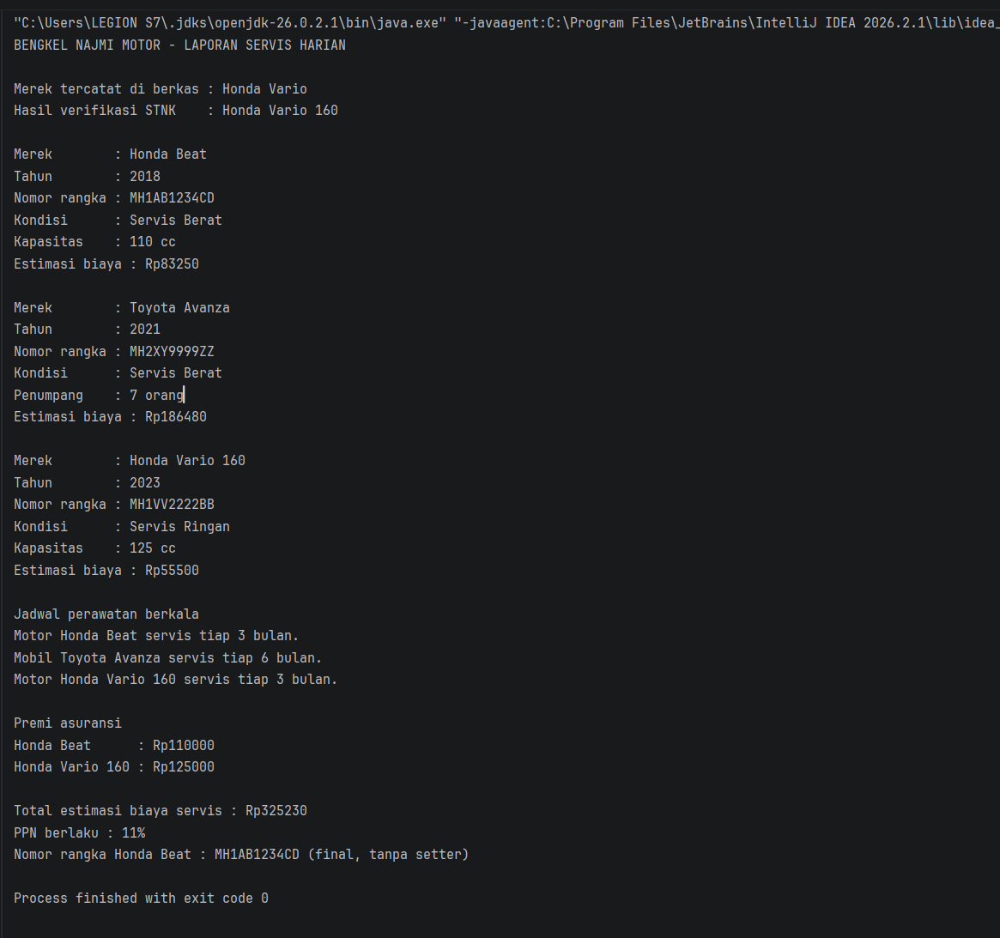

# Responsi Akhir Praktikum Pemrograman Berorientasi Objek

## 1. Identitas Mahasiswa

- **Nama** : Adridinan Najmi Faza
- **NIM** : H1D025059
- **Digit Akhir NIM** : 9
- **Tema Sistem** : Otomotif (Sistem Servis Bengkel Motor dan Mobil)
- **Jurusan** : Informatika, Fakultas Teknik, Universitas Jenderal Soedirman

## 2. Petunjuk Compile dan Run Melalui Terminal

Pastikan terminal dibuka pada direktori proyek (sejajar dengan folder `src`).

### Langkah 1: Compile Program

```
javac -d out src/*.java
```

### Langkah 2: Run Program

```
java -cp out Main
```

## 3. Screenshot Luaran Program


